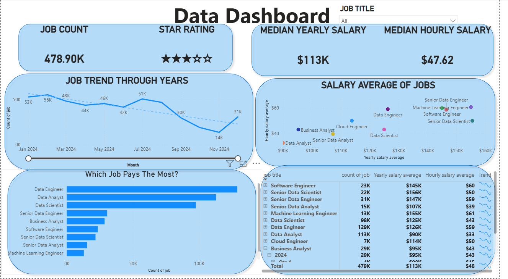
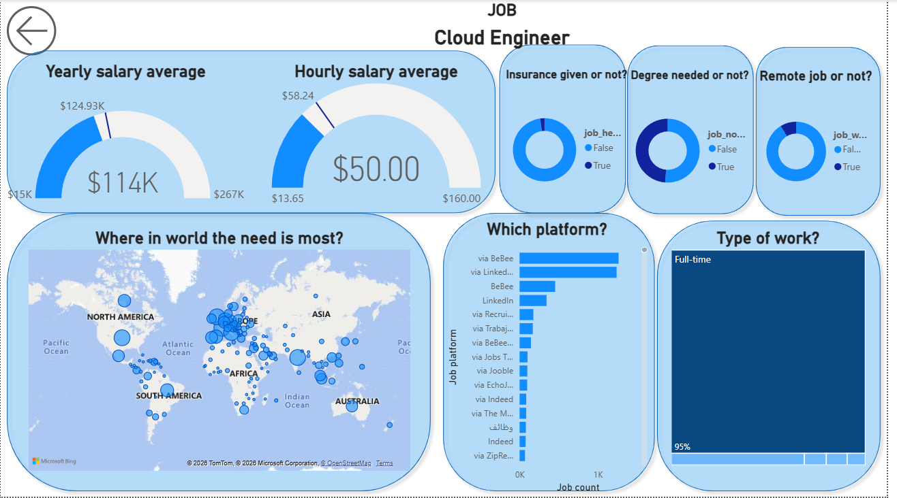

# 📊 Power BI Job Market Dashboard

## 📌 Introduction

This project is an interactive **Power BI Job Market Dashboard** designed to analyze job-market data and provide insights into job demand, salaries, job trends, and employment characteristics.

The dashboard contains two pages:

1. **Job Market Overview** – provides a high-level view of the overall job market.
2. **Job Drill Through** – provides a detailed analysis of the any role using a drill-through style detail page.

The project focuses on turning raw job-market data into an interactive and easy-to-understand dashboard that can support career and job-market analysis.

---

## 🛠️ Skills & Tools Used

- **Microsoft Power BI**
- **Power Query** – data cleaning and transformation
- **Data Modeling** – organizing relationships and analytical fields
- **Data Visualization** – KPI cards, bar charts, line charts, scatter plots, maps, gauges, donut charts and tables
- **Interactive Slicers & Filters**
- **Drill-through / Detail Page Analysis**
- **Calculated Measures & Aggregations**
- **Dashboard UI/UX Design**
- **Trend Analysis**
- **Salary Analysis**
- **Job Market Analysis**

---

# 📄 Page 1 – Job Market Overview



### 🔎 Description

The first page provides a **high-level overview of the job market** and allows users to explore important job and salary indicators.

### Key elements

- **Job Count** – displays the total number of job postings in the dataset.
- **Star Rating** – provides an overall rating indicator.
- **Median Yearly Salary** – shows the median annual salary across the selected data.
- **Median Hourly Salary** – shows the median hourly salary.
- **Job Trend Through Years** – visualizes how the number of job postings changes over time.
- **Salary Average of Jobs** – compares yearly and hourly average salaries across different job titles.
- **Which Job Pays the Most?** – ranks job titles based on job count and provides a comparison of demand.
- **Job Summary Table** – provides a detailed breakdown of job titles, job counts, yearly salary averages, hourly salary averages and trends.
- **Job Title Filter** – allows users to select a specific job title and analyze the dashboard dynamically.

### 🎯 Purpose

This page is designed to answer questions such as:

- How many jobs are available?
- What is the overall salary level?
- How has job demand changed over time?
- Which job roles have higher salaries?
- Which job titles have the highest number of postings?

---

# 📄 Page 2 – Cloud Engineer Details



### 🔎 Description

The second page provides a **detailed analysis of the Cloud Engineer job role as selected**.

It focuses on salary, job requirements, location, job platforms and employment type.

### Key elements

- **Yearly Salary Average** – displays the average yearly salary for Cloud Engineer positions.
- **Hourly Salary Average** – displays the average hourly salary.
- **Insurance Given or Not** – shows the distribution of jobs offering insurance.
- **Degree Needed or Not** – analyzes whether a degree is required for the position.
- **Remote Job or Not** – shows the proportion of remote and non-remote opportunities.
- **Where in the World the Need Is Most?** – map visualization showing the geographic distribution of Cloud Engineer opportunities.
- **Which Platform?** – identifies the job platforms producing the highest number of Cloud Engineer postings.
- **Type of Work?** – shows the employment type, such as full-time work.

### 🎯 Purpose

This page allows users to go beyond the overall job-market view and understand the **specific characteristics of Cloud Engineer opportunities**, including:

- Salary expectations
- Remote-work opportunities
- Education requirements
- Benefits
- Geographic demand
- Job-posting platforms
- Employment type

---

# 📊 Dashboard Features

The dashboard uses several Power BI features to make the analysis interactive:

- KPI cards
- Interactive slicers
- Time-series analysis
- Bar charts
- Scatter plots
- Gauge charts
- Donut charts
- Tables and matrix-style summaries
- Geographic map visualization
- Drill-through/detail analysis
- Dynamic filtering

---

# 💡 Key Insights

The dashboard makes it possible to identify patterns in the job market, such as:

- Job demand changes over time.
- Different job titles have significantly different salary levels.
- Salary and job demand can be compared across roles.
- Cloud Engineer opportunities can be analyzed by location and job platform.
- Remote-work availability and degree requirements can be evaluated for a specific role.
- Salary information can be viewed at both yearly and hourly levels.

> **Note:** The insights above are based on the dashboard visuals and should be interpreted according to the underlying dataset and selected filters.

---

# 📁 Project Structure

```text
PowerBI_Job_Market_Dashboard/
│
├── README.md
│
└── images/
    ├── dashboard-overview.png
    └── cloud-engineer-details.png
```

---

# 🚀 Conclusion

This Power BI project demonstrates how job-market data can be transformed into an **interactive analytical dashboard**.

The first page provides a broad overview of job demand, trends and salaries, while the second page enables a deeper analysis of a specific role such as Cloud Engineer.

Overall, the project demonstrates practical skills in **data preparation, data modeling, visualization, dashboard design and interactive business analysis using Power BI**.

---

## 👤 Author

**Shahabass**

This project was created as part of my Power BI and data analytics learning portfolio.
